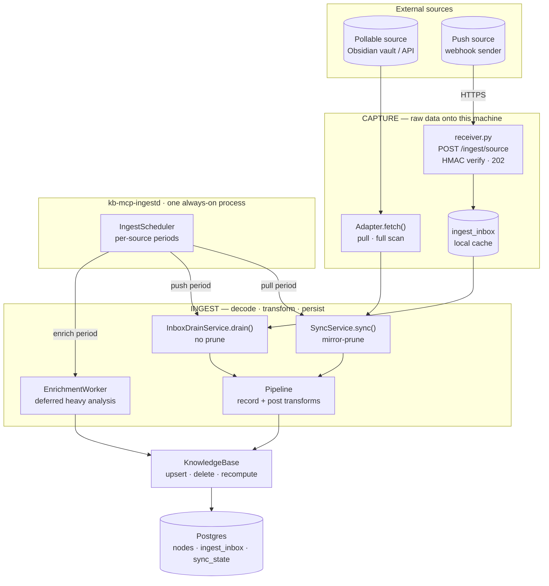
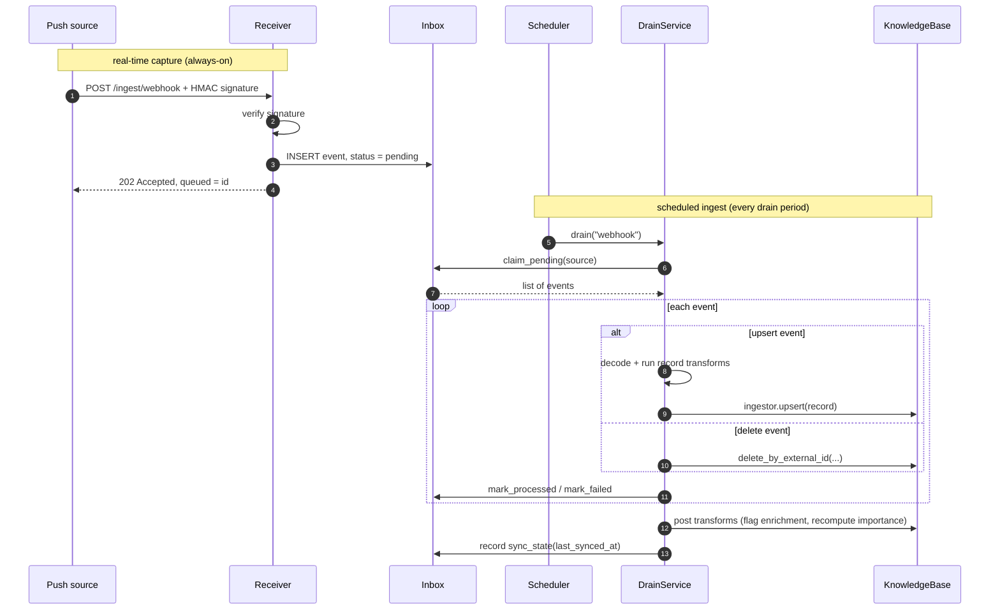
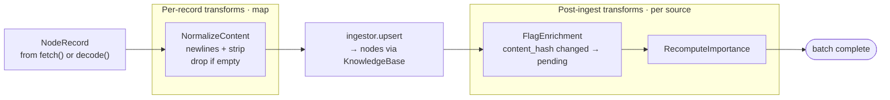
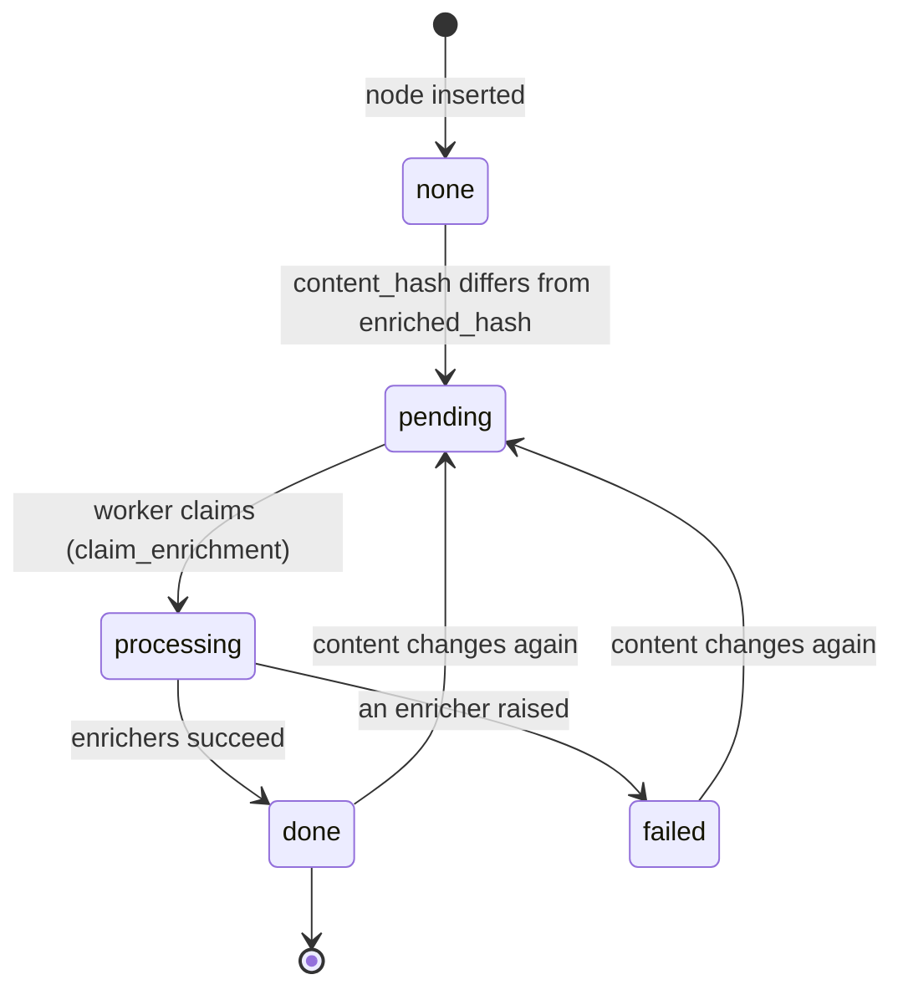
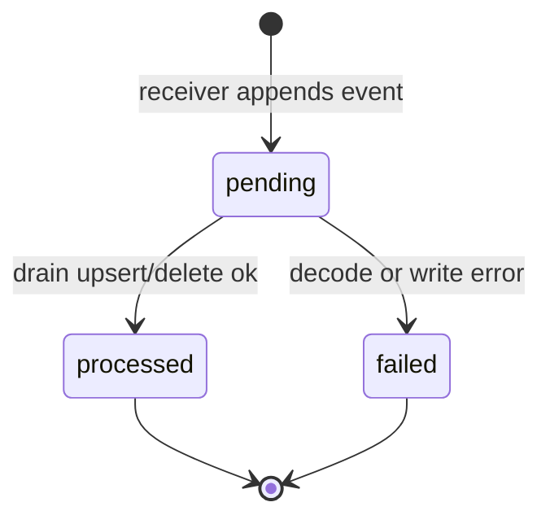
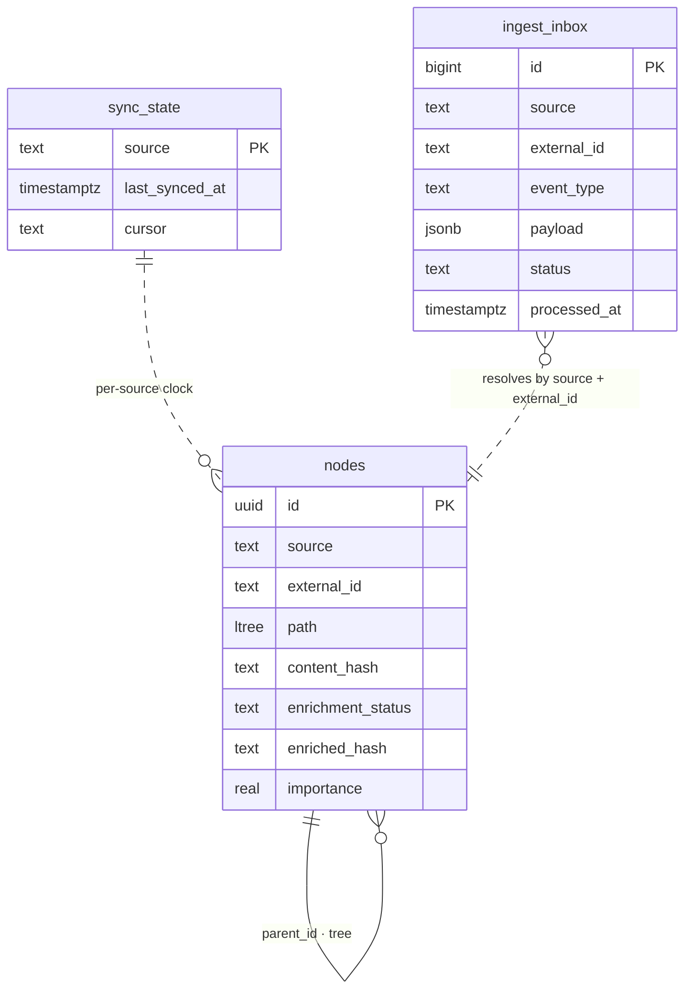

# ego-OS — Ingestion System Architecture (KB_Core)

A visual walkthrough of how data gets **into** the knowledge base (the engine package, `KB_Core/src/kb_core/ingest/` and `KB_Core/src/kb_core/adapters/`): scheduled pulls, real-time pushes, the standard transform stage every record passes through, and deferred heavy analysis.

> **Companion docs:** current-state diagrams [`ingestion-pipeline-visualization.md`](ingestion-pipeline-visualization.md) · [`PRINCIPLES.md`](PRINCIPLES.md).
>
> All diagrams below are [Mermaid](https://mermaid.js.org) and render inline on GitHub, in Obsidian, and in VS Code.

---

## 1. The big idea: separate *capture* from *ingest*

The system splits two verbs that are easy to conflate:

- **Capture** — getting raw source data onto this machine. Either we **pull** it (poll on a timer) or the source **pushes** it (hits a local endpoint that just stages the payload).
- **Ingest** — turning captured data into knowledge-base nodes: **decode → run the transform pipeline → write through `KnowledgeBase`**.

The unifying trick: a **push source is just a source whose records come from a local cache** (the inbox) instead of a remote API. So one scheduler, one pipeline, and one core service serve both paths.



**How to read it:** everything left of `KnowledgeBase` is the ingestion system. One daemon (`kb-mcp-ingestd`) runs the always-on push **receiver** and the **scheduler** that fires each job on its own period. Both ingest paths funnel through the same **Pipeline** and the same **KnowledgeBase** — the only differences are *where the records come from* and *whether removed items get pruned*.

---

## 2. The two capture paths

| | **Pull** (we initiate) | **Push** (the source initiates) |
|---|---|---|
| Trigger | Scheduler fires `fetch()` on a period | Source `POST`s to the receiver in real time |
| Example | Obsidian vault, a pollable API | A webhook sender / live integration |
| Sees | The **whole** source each run (a snapshot) | Only **deltas** (one event at a time) |
| Reconciliation | **Mirror-prune** — delete anything no longer present | **Never prune** — deletes arrive as explicit `delete` events |
| Latency | As fresh as the period | Captured instantly, *cached* until the next drain tick |
| Code | `Adapter.fetch()` + `SyncService.sync()` | `PushDecoder.decode()` + `InboxDrainService.drain()` |

Why push never prunes: a push only ever shows you *what changed*, never the full set — so "delete everything I didn't see this time" would wipe the source. That single rule (`prune=True` for pull, forced `False` for push) is the main correctness pin.

---

## 3. Push, step by step

A push source can't be polled, so it hits an always-on local endpoint. The receiver does **no** knowledge-base work — it verifies the signature, durably stages the raw payload, and returns `202`. The actual ingest happens later, on the scheduled drain tick. This is the "cached locally until the pipeline runs a process" requirement.



**Key properties**
- **Fast, crash-safe ack:** one durable `INSERT`, then `202` — the source never waits on transforms.
- **Authenticated:** every request carries `X-KB-Timestamp` (unix seconds) and `X-KB-Signature` = hex HMAC-SHA256 over `"{ts}\n{METHOD}\n{path}\n{sha256_hex(body)}"`, keyed by `KB_INGEST_SECRET`. This webhook scheme is deliberately simpler than the agent gateway's (which also signs a per-request nonce and the query string), so a sender needs only an HMAC-SHA256 primitive (keep the key off the command line). The path, and so the target source, is signed; a timestamp more than 300 s off the server clock, or a signature already accepted inside that window, is refused. The timestamp is checked before the body is read. Any failure is a neutral `401` and stages nothing. Bodies over 8 MiB are refused with `413` before they are read in full. `/healthz` is the only unauthenticated route; the ingestion log is read through the dashboard API (`/api/ingest/log`), not from the receiver.
- **Refuses a weak key:** the daemon will not start the receiver with an empty, placeholder, or shorter-than-32-character `KB_INGEST_SECRET`.
- **Idempotent:** a retried webhook resolves to the same `node_id(source, external_id)`, so duplicates upsert in place — never a second copy.
- **Principle #2 preserved:** the decoder is pure translation. Marking inbox rows and issuing deletes are database writes, so the **drain orchestrator** owns them — not the source.

---

## 4. The transform pipeline — *analysis & transformation as standard*

Every record — pull or push — flows through the same ordered `Pipeline` before and after it lands. This is where "do analysis and transformations during ingestion" becomes a first-class, uniform stage rather than something each adapter reinvents.



Two stage types, because some analysis is per-item and some is cross-item:

- **Per-record (map):** runs in the produce→persist loop. Cheap, deterministic work — normalize content, derive tags, redact, or **drop** a record entirely. *(`NormalizeContent` ships today.)*
- **Post-ingest (per source):** runs once after the batch. **`RecomputeImportance`** (the importance amplifier — already part of sync) and **`FlagEnrichment`**, which marks new/changed nodes for the heavy worker.

A source's pipeline defaults to `default_pipeline()`; a structured source can append its own stages, and new cheap stages drop into these slots with no orchestration rewrite. Heavy analysis — LLM passes and embeddings (`EmbeddingEnricher` in `ingest/embedding.py`) — runs as enrichers off the hot path (§5), not as pipeline stages. Adapters stay dumb (translate only); the pipeline owns analysis.

---

## 5. Two-phase enrichment (deferred heavy analysis)

Expensive or external work — LLM summaries, embeddings, third-party enrichment — must **not** block a sync or a webhook ack. So ingestion only *flags* a node; a separate scheduled `EnrichmentWorker` does the heavy lifting off the hot path.

The flag is driven by `content_hash`, **not** a timestamp: re-syncing unchanged content costs nothing, while any real content change re-queues the node.



- `FlagEnrichment` (a post-ingest stage) moves new/changed nodes to **pending**.
- The worker **claims** a batch (`pending → processing`, via a status flip, so slow enrichers don't hold row locks), runs the registered enrichers, then marks **done** or **failed**.
- On both success and failure it pins `enriched_hash = content_hash`, so identical content isn't retried in a loop — but a later edit makes the hash distinct again and re-queues it. Enrichers write derived fields (`summary`, `embedding`) and never touch identity or placement.

---

## 6. The inbox event lifecycle

The `ingest_inbox` table is the durable "local cache" between the receiver and the drain. Each row is one event with a simple lifecycle:



A failed event leaves the pending set (it isn't retried forever) and records an error + attempt count for inspection — a richer retry/dead-letter policy is a deferred open question. A partial index on `(source, received_at) WHERE processed_at IS NULL` keeps "next pending for this source" cheap.

---

## 7. The scheduler & daemon

One process (`kb-mcp-ingestd`, kept alive by the `kb-run` supervisor or, on macOS, by launchd) runs the receiver **and** the scheduler. Each unit of work is a `ScheduledJob` with its own period, so "different cadences per adapter" is just `job.period`.

Source jobs are configured in `KB_Core/sources.toml` (path override: `KB_SOURCES_CONFIG`; read relative to the daemon's working directory, so run it from `KB_Core/`), one section per source, parsed by `ingest/config.py`:

| Key | Meaning |
|---|---|
| `enabled` | run this source's job at all (`[obsidian]` also needs `KB_OBSIDIAN_VAULT` set; `[webhook]` and `[vault]` are off unless `enabled = true`) |
| `is_enrichable` | run new/changed nodes through enrichment (gates the `FlagEnrichment` stage) |
| `period_seconds` | how often the job comes due |
| `layer`, `stamp` | `[obsidian]` only: the root folder the vault lands under (default `Obsidian`) and whether to stamp a stable `id:` into unstamped notes (default on); `[vault]` also takes `layer` |

| Job | What it runs | Period |
|---|---|---|
| `obsidian` (pull) | `SyncService.sync()` — fetch + mirror-prune | `[obsidian] period_seconds` (code default 300 when the key is absent; see `sources.toml` for the shipped value — `0` means always due, so the job re-runs as soon as its previous run finishes) |
| `webhook` (push) | `InboxDrainService.drain()` — drain inbox | `[webhook] period_seconds` (default 60) |
| `vault` (push) | `InboxDrainService.drain()` — drain notes pushed by a remote agent | `[vault] period_seconds` (default 20) |
| `enrichment` | `EnrichmentWorker.run()` — drain `pending` nodes | env `KB_ENRICH_PERIOD` (default 120s; idle poll only, see below) |

Each lane wakes when its next job comes due, when it is poked, and at least every `KB_TICK_SECONDS` (default 20, the heartbeat) to log a tick line.

The scheduler seeds each job's next-due time from the persisted `sync_state.last_synced_at`, so a restart **resumes** the cadence instead of re-firing everything. Jobs are grouped into **lanes** (`fast` = pulls/drains, `enrich` = enrichment batches, `slow` = promotion sweeps), one scheduler thread per lane, so a minutes-long enrichment batch never delays ingestion. The receiver's blocking insert runs in a threadpool, so it never stalls the event loop.

For the `enrichment` job the period is only the **idle poll**, never a drain throttle — three mechanisms keep "notes pending but nothing processing" windows out:

- **Backlog chaining** (`ScheduledJob.more`): after each batch the job asks the table whether any `pending` nodes remain (`has_pending_enrichment`), and comes due again immediately if so — regardless of whether its claim happened to be full.
- **Ingestion kick**: a pull/drain of an enrichable source that leaves nodes `pending` pokes the enrich lane (`IngestScheduler.poke`), waking it mid-sleep instead of letting new notes sit out the idle poll.
- **Boot requeue**: nodes stranded at `processing` by a mid-batch shutdown are requeued to `pending` at daemon start (`requeue_stuck_processing`). `flag_stale_enrichment` deliberately leaves in-flight `processing` rows alone — re-flagging them mid-batch only falsified the observable state (every source re-sync used to knock whole claimed batches back to `pending`, reading as "N pending, 0 processing" while enrichment was in full flight).

---

## 8. Data model

Three tables carry ingestion. `nodes` is the universal contract (shown here with only the ingestion-relevant columns); `ingest_inbox` and `sync_state` are this system's additions. The inbox and the clock relate to nodes *logically* by `source` / `(source, external_id)` — they aren't foreign keys.



- **`nodes`** — `enrichment_status` + `enriched_hash` drive the two-phase worker; `content_hash` is the change-detection key; `importance` is the amplifier the post-pipeline recomputes. These columns are **system-managed** (never set by a source).
- **`ingest_inbox`** — the durable push cache; `event_type` is `upsert` | `delete`.
- **`sync_state`** — one row per source; `last_synced_at` is also the scheduler's restart clock; `cursor` is reserved for future incremental (token-based) pulls.

---

## 9. Extension points

Adding a new source is small and local because the orchestration is source-agnostic:

| To add… | You write | The system provides |
|---|---|---|
| A **pull** source | An `Adapter` (`source`, `fetch() → NodeRecord`) | scheduling, pipeline, mirror-prune, importance |
| A **push** source | A pure `PushDecoder` (`decode(payload) → NodeRecord`) + its endpoint contract | receiver, inbox, drain, delete handling, status |
| Custom **persistence** (e.g. a typed-extension row) | An `Ingestor` in `adapters/<source>/ingest.py` | the upsert seam, used by both paths |
| New **analysis** | A `RecordTransform` or `PostIngestTransform` | per-source pipeline resolution |
| Heavy/external **enrichment** | An `Enricher` registered with the worker | deferred scheduling off the hot path |

---

## 10. Running it

Behaviour (which sources run, how often, whether they enrich) lives in `KB_Core/sources.toml`, as above; the environment carries only secrets and machine paths:

```bash
cd KB_Core

# environment
export KB_DATABASE_URL=postgresql://kb_app:<KB_APP_PASSWORD>@localhost:5433/kb_mcp
export KB_INGEST_SECRET=$(openssl rand -hex 32)   # required; HMAC for the receiver

# pull source (optional): unset = no vault job
export KB_OBSIDIAN_VAULT=/path/to/your/obsidian-vault

# optional tuning
export KB_TICK_SECONDS=20      # scheduler heartbeat / max idle sleep (default 20)
export KB_ENRICH_PERIOD=120    # enrichment idle poll (default 120)

uv run kb-mcp-ingestd        # receiver on 127.0.0.1:8030 + scheduler threads
```

To turn the webhook drain on or off, or change a period, edit the matching section of `sources.toml` (for example `[webhook] enabled = true`, `period_seconds = 60`) and restart the daemon.

Send a push event (signed — timestamp, method, path and body hash):

```bash
# From KB_Core/, with KB_INGEST_SECRET exported. The secret is read inside Python, never
# passed on argv (an `openssl -hmac "$SECRET"` call would show it in `ps`).
uv run python - <<'PY'
import json, os, urllib.request
from kb_core.ingest.receiver import signed_headers
body = json.dumps({"event_type": "upsert", "external_id": "evt-1", "payload": {
    "external_id": "evt-1", "title": "Hello", "content": "from a webhook"}}).encode()
headers = signed_headers(os.environ["KB_INGEST_SECRET"], "/ingest/webhook", body)
req = urllib.request.Request("http://127.0.0.1:8030/ingest/webhook", data=body,
                             method="POST", headers=headers)
print(urllib.request.urlopen(req).read().decode())   # -> {"queued": <id>}
PY
# ... ingested on the next drain tick
```

From Python, `kb_core.ingest.receiver.signed_headers(secret, "/ingest/webhook", body)`
builds the same headers.

The receiver binds `127.0.0.1` and is meant to stay there: its only protection is the
shared HMAC key, with no per-sender identity, rate limit or revocation. Run senders on
the same machine. Do not publish it through a tunnel or reverse proxy; a remote machine
that needs to push data should use the agent gateway (per-tenant keys) instead.
