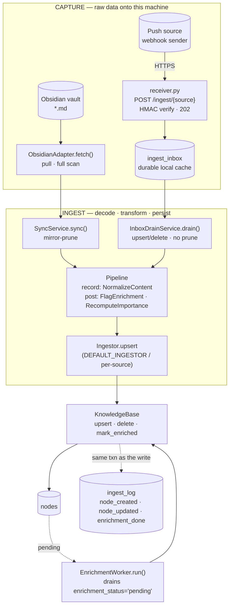
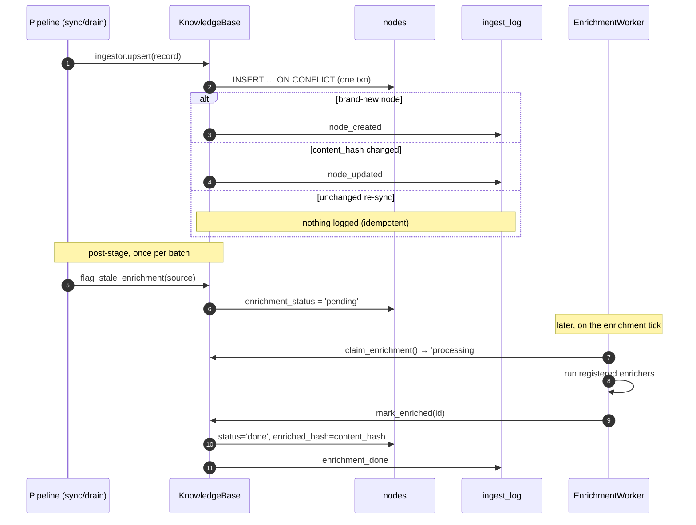
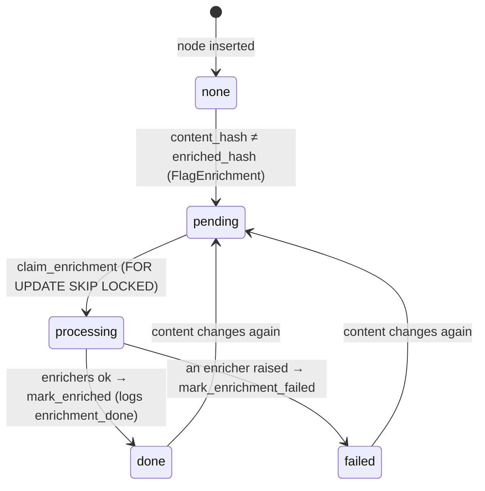
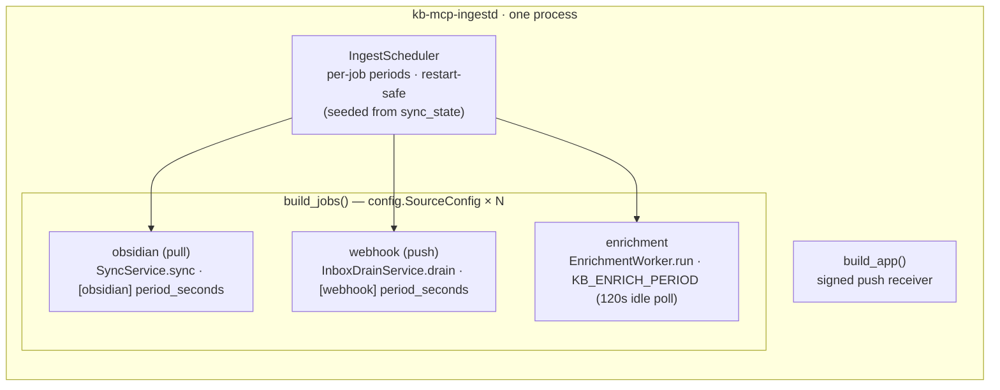

# ego-OS — Ingestion Pipeline, as built (KB_Core)

A code-accurate map of the ingestion pipeline **as implemented** in `KB_Core/src/kb_core/ingest/`
and `KB_Core/src/kb_core/adapters/`. Every box names a real module/class, so you can read a diagram
and jump straight to the file.

> **Companion docs:** design-time diagrams [`ingestion-architecture.md`](ingestion-architecture.md) · [`PRINCIPLES.md`](PRINCIPLES.md).
>
> All diagrams are [Mermaid](https://mermaid.js.org) and render inline on GitHub, Obsidian, and VS Code.

---

## 1. End-to-end: one pipeline, two capture paths, one observable log

Pull and push **capture** differently but funnel through the **same** transform pipeline,
the same `Ingestor`/`KnowledgeBase` core, and the same identity — then every write is
mirrored into the `ingest_log` audit table.



**Read it:** everything left of `KnowledgeBase` is the ingestion system. The only
differences between the two paths are *where records come from* (`fetch()` vs the inbox)
and *whether removed items are pruned* (pull mirror-prunes; push never does — it sees
deltas). `ingest_log` is written **inside the same transaction** as the node write, so it
can never drift from what actually landed.

---

## 2. Node lifecycle & the observability log

When each `ingest_log` row is emitted — the "what just happened to my data" view. An
idempotent re-sync (unchanged `content_hash`) deliberately logs **nothing**, keeping the
log signal-only.



View it any time:

```sql
SELECT at, event, source, external_id, path FROM ingest_log ORDER BY at DESC LIMIT 50;
```

…or through the dashboard API, behind its auth: `GET /api/ingest/log?limit=50`.

---

## 3. Enrichment status machine

`content_hash` (not a timestamp) drives the flag, so re-syncing unchanged content is free
while any real edit re-queues the node.



---

## 4. The daemon: every source is a standard scheduled task

`build_jobs()` is the single place each source becomes a `ScheduledJob`; the daemon runs
the push receiver and the scheduler in one always-on process. Each job carries its **own
pipeline** (`cfg.pipeline`) — the per-adapter transformation seam. Source periods and
toggles come from `KB_Core/sources.toml` (see `sources.toml` for shipped values; a
`period_seconds` of `0` means always due, re-running as soon as the previous run
finishes); the full key list is in [`ingestion-architecture.md`](ingestion-architecture.md) §7.



---

## 5. Box → file map

Paths are relative to `KB_Core/src/kb_core/`.

| Diagram box | Lives in |
|---|---|
| `ObsidianAdapter.fetch()` | `adapters/obsidian/adapter.py` |
| `receiver.py` / `build_app` | `ingest/receiver.py` · `ingest/daemon.py` |
| `ingest_inbox` / `Inbox` | migration `0004` · `ingest/inbox.py` |
| `SyncService.sync()` | `sync.py` |
| `InboxDrainService.drain()` | `ingest/drain.py` |
| `Pipeline` + transforms | `ingest/pipeline.py` · `ingest/transforms.py` |
| `Ingestor` / `DEFAULT_INGESTOR` | `adapters/base.py` |
| `KnowledgeBase` (upsert · mark_enriched) | `knowledge_base.py` |
| `ingest_log` | migration `0005_ingest_log.sql` |
| `EnrichmentWorker` / `Enricher` | `ingest/enrichment.py` |
| `IngestScheduler` / `ScheduledJob` | `ingest/scheduler.py` |
| `SourceConfig` / `build_jobs` / daemon | `ingest/config.py` · `ingest/daemon.py` |
