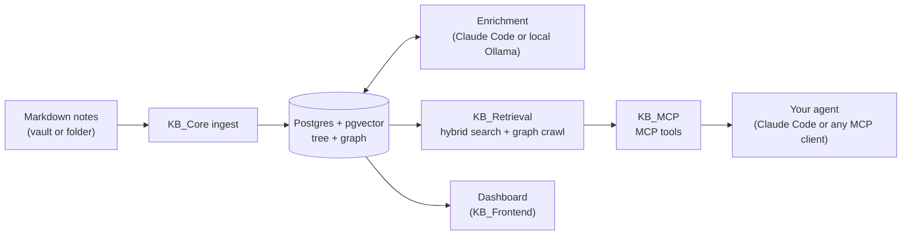

# ego-OS

[](https://github.com/XxMorganxX/Ego-OpenSource/actions/workflows/ci.yml)
[](LICENSE)

**A personal memory graph for your AI agents.** ego-OS ingests a folder of Markdown
notes (an Obsidian vault or any folder of `.md` files) into Postgres + pgvector, uses an
LLM to extract entities and cluster them into concepts, and serves the result to Claude
Code or any other MCP client through 32 tools. A web dashboard lets you browse the same
graph yourself.

- **Hybrid search** (full-text + vector, fused) and a deterministic concept/entity graph crawl
- **Open-vocabulary entities** (people, projects, tools), with merge suggestions you approve
- **Concepts**: topics clustered from memories and entities, labelled, ranked by activity
- **Self-healing enrichment**: pauses on lost quota or auth and resumes by itself
- **Measured retrieval**: golden sets, eval harnesses, and a dashboard trace of agent calls
- **Runs on your machine**: one supervisor command (`kb-run`); Postgres is the only container

## How it fits together



One repository, six packages, one Postgres database:

| Directory | What it is |
|---|---|
| [`KB_Core/`](KB_Core/README.md) | The engine: schema and migrations, ingest daemons, enrichment, entity and concept layers, dashboard API |
| [`KB_Retrieval/`](KB_Retrieval/README.md) | Retrieval strategies behind one contract: ranking, fusion, graph traversal, confidence |
| [`KB_MCP/`](KB_MCP/README.md) | The MCP server: a thin tool layer over the engine |
| [`KB_Inference/`](KB_Inference/README.md) | Local model server (FastAPI over Ollama): chat model and embeddings |
| [`KB_Frontend/`](KB_Frontend/README.md) | The dashboard web UI (React) |
| [`KB_Agent/`](KB_Agent/README.md) | An optional agent for hosted setups (not needed for a single-user install) |

`evals/` holds the golden sets and harnesses. [`docs/`](docs/README.md) holds the setup
guide, the operations guide and the LLM call map.

## What your agent can do

Every tool runs against your own database. The dashboard can switch any tool off for
every client (behind the `KB_DB_VIEWER_PASSWORD` gate, see `KB_Core/.env.example`).

| Group | Tool | | What it does |
|---|---|---|---|
| Search | `search_memories` | read | Hybrid keyword + semantic search over notes, with a confidence verdict |
| | `search_graph` | read | Topic questions: routes the query to concepts and entities, crawls them, fuses with flat search |
| | `expand` | read | One-hop neighbourhood of a memory, entity or concept |
| Read | `get_memory` | read | One memory by id or path |
| | `list_memories` | read | Browse a subtree, optionally by doc kind |
| | `find_entity` | read | Resolve a name, misspelling or description to entities |
| | `get_entity` | read | One entity: description, aliases, classes, mention count |
| | `entity_activity` | read | Time-ordered memories that mention an entity |
| | `list_concepts` | read | The concept catalogue, ranked, with a "current goal" signal |
| | `concept` | read | One concept and its scored members |
| | `list_doc_kinds` | read | The document-kind facet ("meeting notes", "plan", ...) |
| Write | `add_memory` | write | Create a memory |
| | `update_memory` | write | Edit a memory's title, content, summary, tags |
| | `move_memory` | write | Move a memory (and its subtree) |
| | `delete_memory` | write | Delete a memory, optionally its subtree |
| | `set_importance` | write | Boost or suppress a memory in ranking |
| | `sync_source` | write | Re-sync a configured source (the notes folder) now |
| Curation | `list_merge_suggestions` | read | Pending near-duplicate entity merges |
| | `approve_merge` | write | Merge a suggested pair |
| | `reject_merge` | write | Reject a pair so it is never suggested again |
| Skills | `search_skills` | read | Discover: name, description, approved (served) revision per row |
| | `get_skill` | read | The full `SKILL.md` (approved revision by default), file manifest, archive state, history |
| | `get_skill_file` | read | One supporting file at the revision `get_skill` returned |
| | `upsert_skill` | write | Create or overwrite with the complete package; the new revision is pending until reviewed |
| | `delete_skill` | write | Archive; revisions stay readable; approving a later revision reactivates it |
| | `review_skill` | write | Approve or reject one pending revision, bound to its package hash; required after every write |
| Agents | `search_agents` | read | Discover saved Claude Code subagents: name, description, approved revision per row |
| | `get_agent` | read | The full `AGENT.md` (approved revision by default), archive state, history |
| | `upsert_agent` | write | Create or overwrite the agent definition; the new revision is pending until reviewed |
| | `delete_agent` | write | Archive; approving a later revision reactivates it |
| | `review_agent` | write | Approve or reject one pending agent revision, bound to its package hash |
| Library | `list_pending_reviews` | read | Skill and agent revisions waiting for review, oldest first |

Ask Claude *"what did we decide about the forecast pilot, and who was involved?"* and it
will typically call `search_graph`, then `expand` on the project it found with
`classes=["person"]`. More detail: [`KB_MCP/README.md`](KB_MCP/README.md).

## Requirements

macOS or Linux (macOS is the most tested), plus:

- **Docker**: runs Postgres. Every other service runs as a normal process on the host.
- **[uv](https://docs.astral.sh/uv/)**: manages the Python environments and fetches
  Python 3.11+ for you.
- **Node.js 22+**: builds the dashboard.
- **git, python3 and openssl**: the quickstart commands below use them.
- **[Ollama](https://ollama.com)**: serves the embedding model (`qwen3-embedding:0.6b`,
  small) and the local chat model (`gemma4:12b-it-q8_0`, about 13 GB). Start it yourself
  (`ollama serve` or the menu-bar app). `kb-run` pulls any missing models.

> **The default setup also needs Claude Code and a paid Claude subscription.** The
> shipped [`KB_Core/inference.toml`](KB_Core/inference.toml) sends 7 of its 11
> enrichment tasks (entity extraction, classification, concept labels and others) to
> the `claude` CLI. Each note's text then goes to Anthropic under **your own** Claude
> Code login, and the first ingest of a large folder uses real quota. Log in once with
> `claude` before you start the stack. For a setup where note text never leaves your
> machine, see [Enrichment providers](#enrichment-providers).

**Hardware.** Embeddings run anywhere. `doc_kind`, `describe_entity` and `merge_judge`
run the local chat model by default, so plan on 32 GB+ of unified memory (Apple Silicon)
or an equivalent GPU.

## Try it in 5 minutes (demo data, no models)

This runs ego-OS on [`examples/demo-vault/`](examples/demo-vault/), a small invented
vault, in its own Docker project. No Ollama, no Claude login, and no note text leaves
your machine. Search is keyword-only in this mode, and the demo notes are not modified.

```bash
git clone https://github.com/XxMorganxX/Ego-OpenSource.git ego-os && cd ego-os
cp KB_Core/.env.example KB_Core/.env
python3 - <<'PY'
import pathlib, re, secrets
p = pathlib.Path("KB_Core/.env"); s = p.read_text()
for k, v in {
    "POSTGRES_PASSWORD": secrets.token_hex(24),
    "KB_APP_PASSWORD": secrets.token_hex(24),
    "KB_INGEST_SECRET": secrets.token_hex(32),
    "KB_OBSIDIAN_VAULT": str(pathlib.Path("examples/demo-vault").resolve()),
    "KB_OBSIDIAN_STAMP": "0",                  # never write into the demo notes
    "KB_SOURCES_CONFIG": str(pathlib.Path("examples/demo-sources.toml").resolve()),
    "KB_COMPOSE_PROJECT": "ego_demo",          # its own container and volume
}.items():
    pat = re.compile(rf"^#?[ \t]*{k}=.*$", re.M)
    s = pat.sub(f"{k}={v}", s, count=1) if pat.search(s) else s.rstrip("\n") + f"\n{k}={v}\n"
p.write_text(s)
PY
(cd KB_Core && docker compose up -d --wait)
uv run --project KB_Core kb-run --only backend,frontend,ingest,mcp
```

The first run takes a few minutes: it syncs each Python environment and builds the
dashboard. Then:

- Open **http://127.0.0.1:8091** to browse the demo notes.
- Connect an agent: `claude mcp add --transport http ego-demo http://127.0.0.1:3000/mcp`,
  then ask *"how was the duplicate SKU bug fixed?"*. Any MCP client
  works; the server speaks streamable HTTP at `http://127.0.0.1:3000/mcp`.
- `examples/demo-sources.toml` turns enrichment off, so no entities or concepts appear
  in this mode. The dashboard may show a warning that inference is unreachable. That is
  expected here.
- `Ctrl-C` stops the services. `(cd KB_Core && docker compose down -v)` deletes this
  compose project's database volume.

## Quickstart (your own notes)

> **Using an agent?** Point it at [`docs/setup/README.md`](docs/setup/README.md), or in
> Claude Code run `/setup-kb`. It does everything below and asks you four questions.

**1. Configure.** `cp KB_Core/.env.example KB_Core/.env` (a fresh copy, even if you ran
the demo: the demo's `.env` turns enrichment off), then set:

- `POSTGRES_PASSWORD` and `KB_APP_PASSWORD`: generate each with `openssl rand -hex 24`.
  No single quotes. The database init scripts run only once, on a new volume.
- `KB_INGEST_SECRET`: `openssl rand -hex 32` (the ingest daemon refuses short or
  placeholder values).
- `KB_OBSIDIAN_VAULT`: the absolute path of your notes folder. Despite the name, any
  folder of Markdown works.

> **ego-OS writes one line into your notes.** To keep a note's identity stable across
> renames, ingest adds an `id:` line to the YAML frontmatter of every note it reads.
> Set `KB_OBSIDIAN_STAMP=0` to turn this off (identity then follows the file path). Try
> it first on a copy of your vault, or on the demo vault above.

**2. Start.** Run this from the repository root:

```bash
(cd KB_Core && docker compose up -d --wait)   # Postgres; creates roles + test DB on first init
uv run --project KB_Core kb-run               # the eight default services; Ctrl-C stops them all
```

`kb-run` restarts crashed services. The first run pulls models and builds everything.

**3. Connect** your agent, then open the dashboard:

```bash
claude mcp add --transport http kb-mcp http://127.0.0.1:3000/mcp
```

The dashboard is at **http://127.0.0.1:8091**. Its Ingestion page shows enrichment
progress. If a provider is not ready yet (for example, Ollama is still starting),
enrichment pauses and resumes on its own.

Run at boot, second instances, ports and models: [`docs/operations.md`](docs/operations.md).

## Enrichment providers

[`KB_Core/inference.toml`](KB_Core/inference.toml) routes each inference task to one of
three providers. It is read at service start: restart after a change.

- **`local`**: your Ollama, through `KB_Inference`. Free and private; `embed` must stay local.
- **`claude-cli`**: `claude -p` under your Claude Code login, billed to your subscription.
  Without a login those tasks stay paused; notes are still ingested and embedded.
- **`anthropic`**: the metered Messages API (`ANTHROPIC_API_KEY` in `KB_Core/.env`).

**Shipped routing:** `entity_gate`, `discover_classes`, `classify_memory`,
`extract_entities`, `meaning_gate`, `curate_parse` (Haiku) and `concept_label` (Sonnet)
use `claude-cli`. `doc_kind`, `describe_entity`, `merge_judge` and `embed` use `local`.

**All-local:** in those seven `[task.*]` blocks, change `provider = "claude-cli"` to
`provider = "local"` and delete the `model = ...` line in `concept_label`. Note text then
never leaves your machine, but enrichment is much slower. Startup fails loudly if a
task's block is missing.

## Project status

**v0.1.0, early.** One maintainer, built for one user on one machine. It is developed and
run daily on macOS; Linux is supported through `kb-run`. Expect rough edges and breaking
changes before 1.0.

**How this repository works.** ego-OS has been developed in a private repository since
June 2026 (1,280+ commits as of v0.1.0). This public repository is a filtered mirror: an
allowlist export publishes one `sync:` commit per release, and the `upstream <sha>` in a
sync commit's message refers to that private history. Issues work normally. Pull
requests are welcome, but they are imported upstream rather than merged here; see
[CONTRIBUTING](CONTRIBUTING.md).

- [Contributing](CONTRIBUTING.md) (tests, lint, what happens to a PR) ·
  [Code of conduct](CODE_OF_CONDUCT.md) · [Security policy](SECURITY.md) (report
  vulnerabilities privately) · [Changelog](CHANGELOG.md)

## Further reading

- [Design principles](KB_Core/docs/PRINCIPLES.md) ·
  [Ingestion architecture](KB_Core/docs/ingestion-architecture.md) ·
  [Pipeline as built](KB_Core/docs/ingestion-pipeline-visualization.md)
- [Operations](docs/operations.md): services, ports, run at boot, second instances,
  your own sources, per-install policy
- [Exposing ego-OS beyond localhost](docs/exposure.md) ·
  [LLM call map](docs/llm-inference-map.md) · [All docs](docs/README.md)

## About the name

The product is **ego-OS** (ego-Operating System). Its components keep the historical
`KB_` / `kb-` prefix (KB = knowledge base): `KB_Core`, `kb-run`, `KB_*` settings. The
public repository is **Ego-OpenSource**, a play on the same acronym (OS = OpenSource).

## License

ego-OS is licensed under the [Apache License 2.0](LICENSE); see also [NOTICE](NOTICE).

ego-OS's own code is Apache-2.0, but some Python dependencies it installs use copyleft
licenses (as declared in each package's own metadata):

| Package | License | Used for |
|---|---|---|
| `leidenalg` | GPL-3.0-or-later | concept clustering (Leiden communities) |
| `igraph` (python-igraph) | GPL (the wheel's metadata says only "GPL" and ships the GPL v2 text) | graph structure for concept clustering |
| `html2text` | GPL-3.0-or-later | declared in `KB_Core/pyproject.toml`; nothing in this repository imports it today |
| `psycopg`, `psycopg-binary`, `psycopg-pool` | LGPL-3.0-only | Postgres driver and pool |

`certifi` (MPL-2.0) and, in `KB_Inference`, `orjson` (partly MPL-2.0) arrive
transitively; the frontend's npm dependencies are permissive. Nothing is vendored: all of
it installs from PyPI/npm. If you redistribute ego-OS in a bundled form (an app, a
container image), check how those licenses apply.

---

Maintained by @XxMorganxX.
